# Deepfake Detection System Report

**Project:** Fine-Tuned XceptionNet Deepfake Detection Platform  
**Repository:** `deepfake-detection-XceptionNet-main`  
**Generated:** April 23, 2026 09:06  
**Primary checkpoint:** `identity_grouped` split, best model at `own_train/runs/20260422_231937_xception/checkpoints/best_model.pt`

## Abstract

This report documents the end-to-end development of a deepfake detection system built around a fine-tuned XceptionNet classifier, an MTCNN-based face extraction pipeline, explainability modules, and a production-oriented FastAPI plus React deployment stack. The model was re-trained on the local `Dataset` directory using an identity-grouped split to reduce subject leakage, then integrated into the backend with the same preprocessing used during training. The resulting system combines frame-level image analysis, ratio-based video analysis, metadata inspection, face landmark visualization, Grad-CAM, LIME, PDF reporting, and an interactive forensic dashboard.

The final fine-tuned model achieved **95.37% test accuracy**, **95.02% test F1-score**, and **0.9919 test AUC**, while retaining strong validation performance. A representative fake-image verification sample was classified as **FAKE** with **99.98% confidence**, and the representative fake-video verification run was classified as **FAKE** with **88.52% fake-frame ratio**.

## Objectives

1. Fine-tune a stronger XceptionNet checkpoint on the provided local dataset.
2. Keep the backend preprocessing aligned with the training pipeline.
3. Build an explainable detection workflow for both images and videos.
4. Provide a professional frontend suitable for demonstrations and forensic interpretation.
5. Generate reproducible results, plots, and assets suitable for publication-style reporting.

## System Overview

The final system consists of four tightly connected layers:

1. **Training layer:** `own_train/` contains the fine-tuning pipeline, grouped splitting logic, metric tracking, checkpointing, and plotting.
2. **Inference layer:** `backend/predictor.py` loads the fine-tuned Xception model, applies the training-consistent preprocessing (`299x299` with ImageNet normalization), detects faces via `from mtcnn import MTCNN`, and produces image/video predictions.
3. **Forensic analysis layer:** `backend/explainability.py`, `backend/forensics.py`, and `backend/face_landmarks.py` generate Grad-CAM, LIME, metadata flags, and landmark overlays.
4. **Application layer:** FastAPI routes in `backend/main.py` expose image, batch, video, WebSocket, and PDF-report endpoints, while the React/Vite frontend presents uploads, thresholds, timelines, trigger frames, comparison mode, and session history.

## Dataset and Split Strategy

The training process used the local `Dataset` folder and applied an **identity-grouped split** to reduce train/validation/test leakage.

### Split Summary

| Split | Identities | Samples | Real Frames | Fake Frames |
| --- | ---: | ---: | ---: | ---: |
| Train | 699 | 102,211 | 22,360 | 79,851 |
| Validation | 149 | 9,240 | 4,761 | 4,479 |
| Test | 151 | 8,986 | 4,828 | 4,158 |

### Training Fake-Method Distribution

| Manipulation Method | Training Frames |
| --- | ---: |
| Deepfakes | 15,919 |
| Face2Face | 15,985 |
| FaceShifter | 15,969 |
| FaceSwap | 15,990 |
| NeuralTextures | 15,988 |

Additional leakage-control details:

- Cross-split fake frames dropped: **71,113**
- Cross-split fake groups dropped: **2,226**
- Retained fake groups: **2,770**

## Training Configuration

| Parameter | Value |
| --- | --- |
| Backbone | xception |
| Pretrained initialization | True |
| Image size | 299 |
| Batch size | 32 |
| Epochs | 12 |
| Frozen epochs | 2 |
| Learning rate | 0.0001 |
| Weight decay | 0.0001 |
| Patience | 4 |
| Weighted sampler | True |
| Mixed precision | True |
| Decision threshold during training evaluation | 0.5 |
| Best epoch | 12 |
| Training time | 521.54 minutes |
| Runtime device | cuda |

The fine-tuning pipeline used a warmup phase for the classifier head followed by full-network adaptation. Checkpoint selection was validation-driven, with early stopping and plot generation integrated into the workflow.

## Quantitative Results

### Validation Metrics

| Metric | Value |
| --- | ---: |
| Accuracy | 97.22% |
| Precision | 96.33% |
| Recall | 97.99% |
| F1-score | 97.16% |
| AUC | 0.9942 |
| Loss | 0.0837 |

### Test Metrics

| Metric | Value |
| --- | ---: |
| Accuracy | 95.37% |
| Precision | 94.59% |
| Recall | 95.45% |
| F1-score | 95.02% |
| AUC | 0.9919 |
| Loss | 0.1123 |

### Training and Evaluation Figures

### Learning Curves

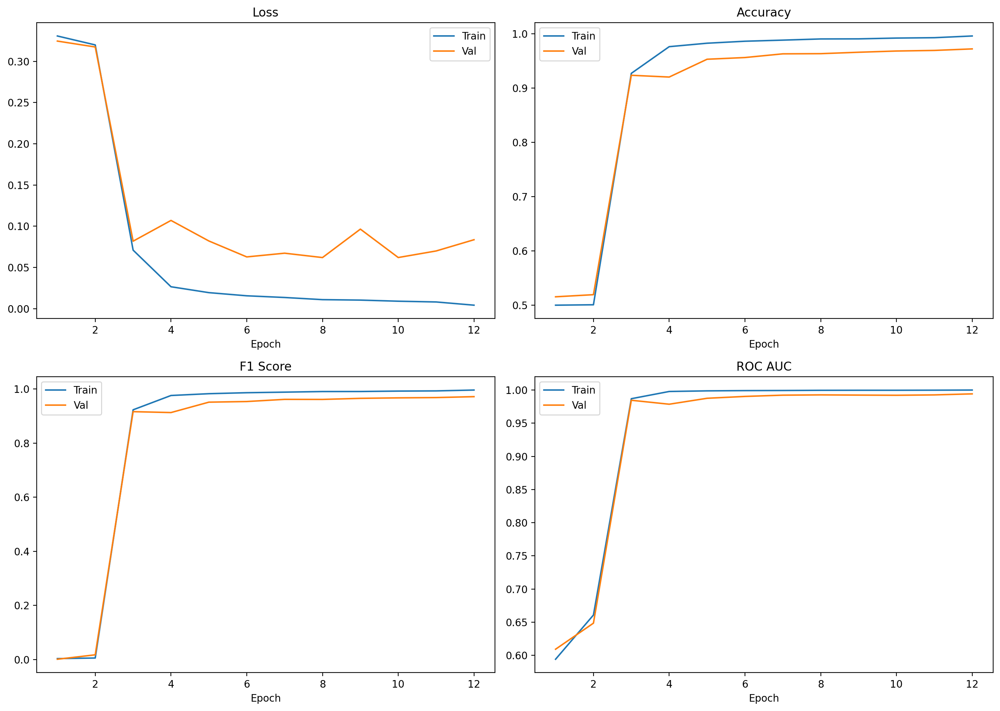

*Training and validation loss/metric evolution across epochs.*

### Validation Confusion Matrix

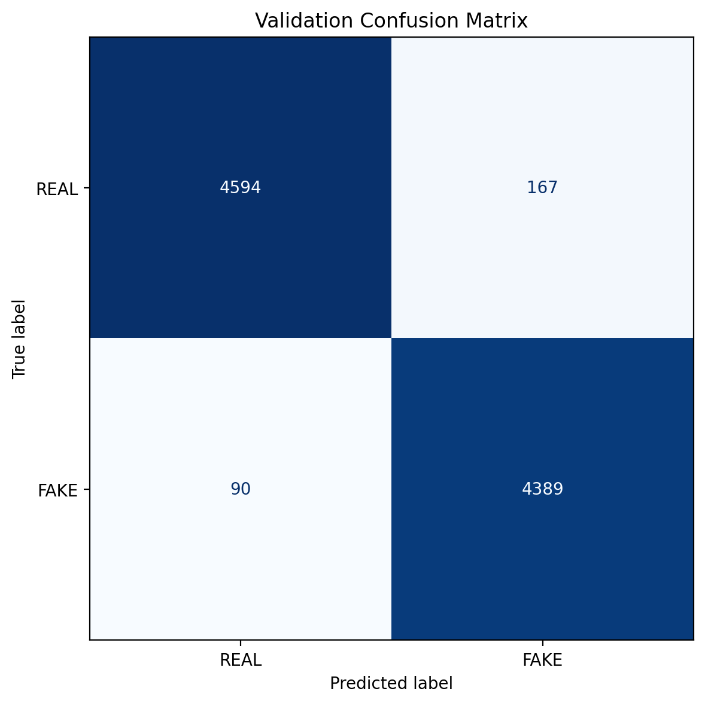

*Validation-set confusion matrix for the selected checkpoint.*

### Test Confusion Matrix

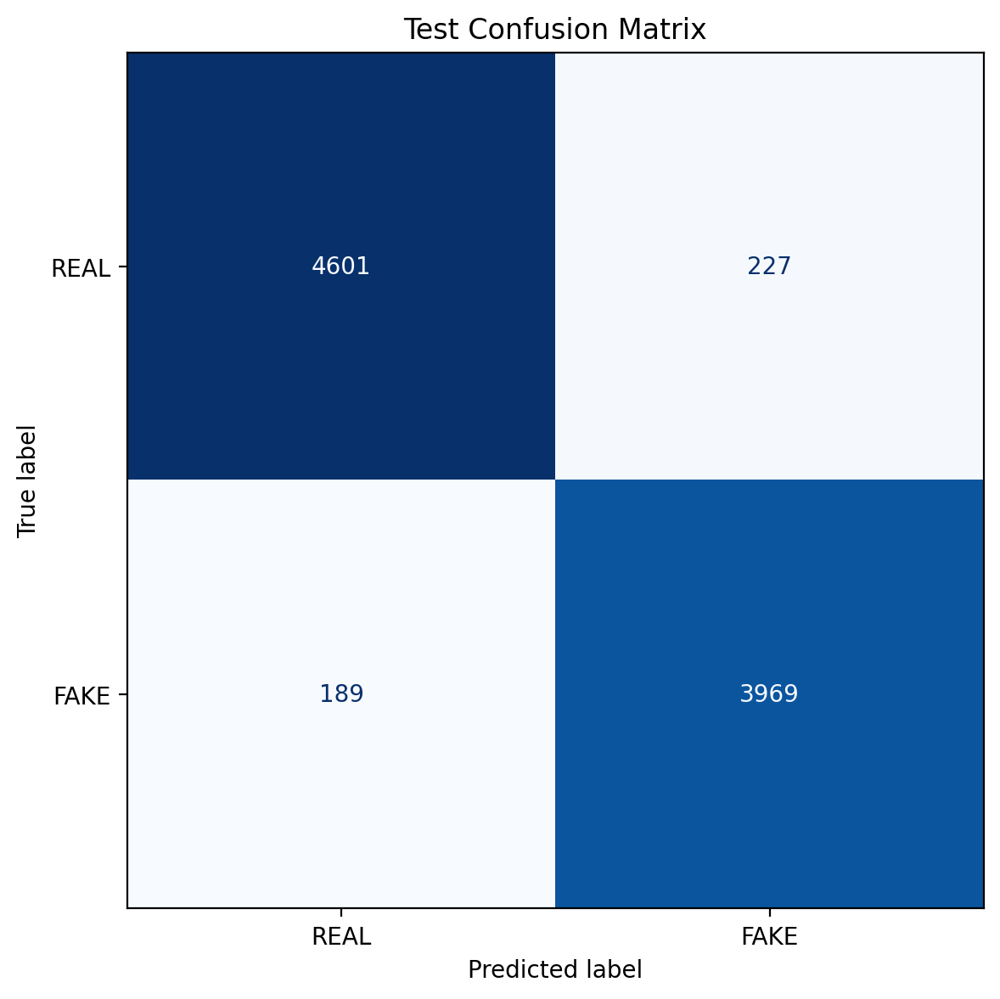

*Test-set confusion matrix showing generalization of the final model.*

### Validation ROC Curve

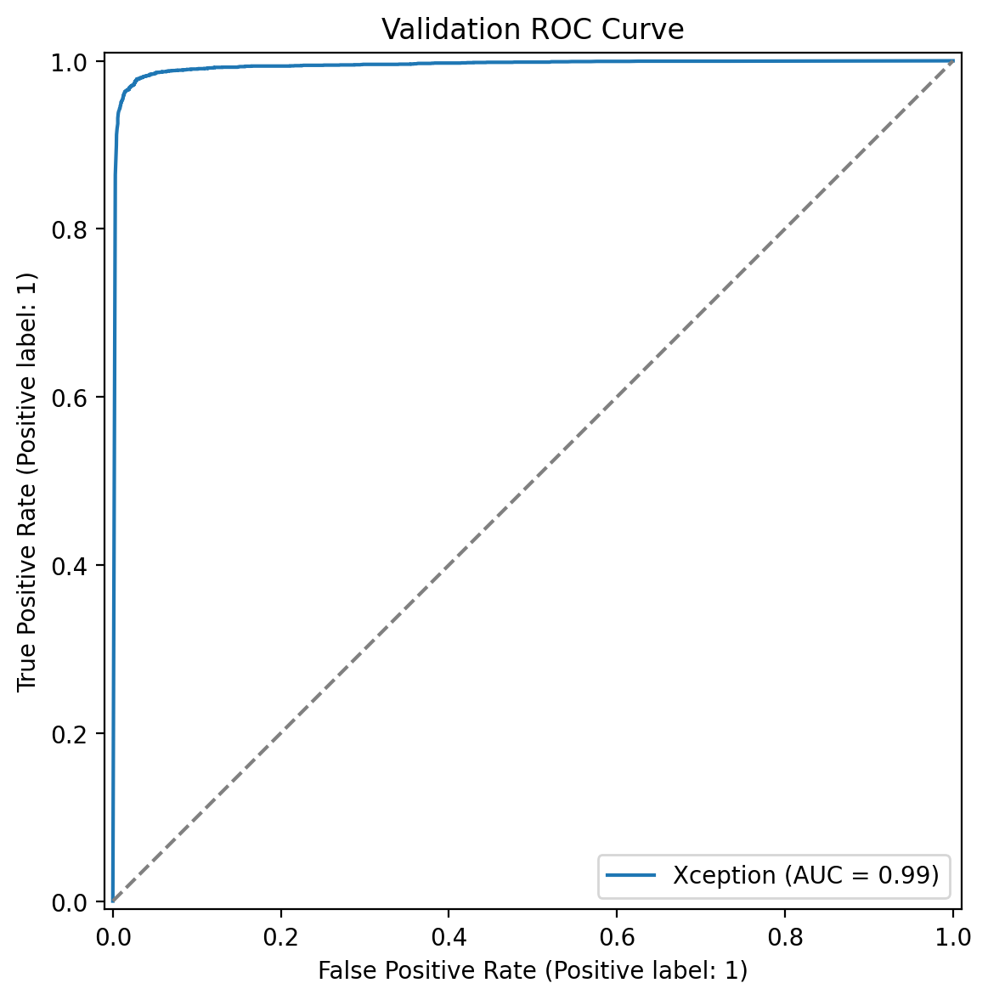

*Validation ROC curve with strong class separability.*

### Test ROC Curve

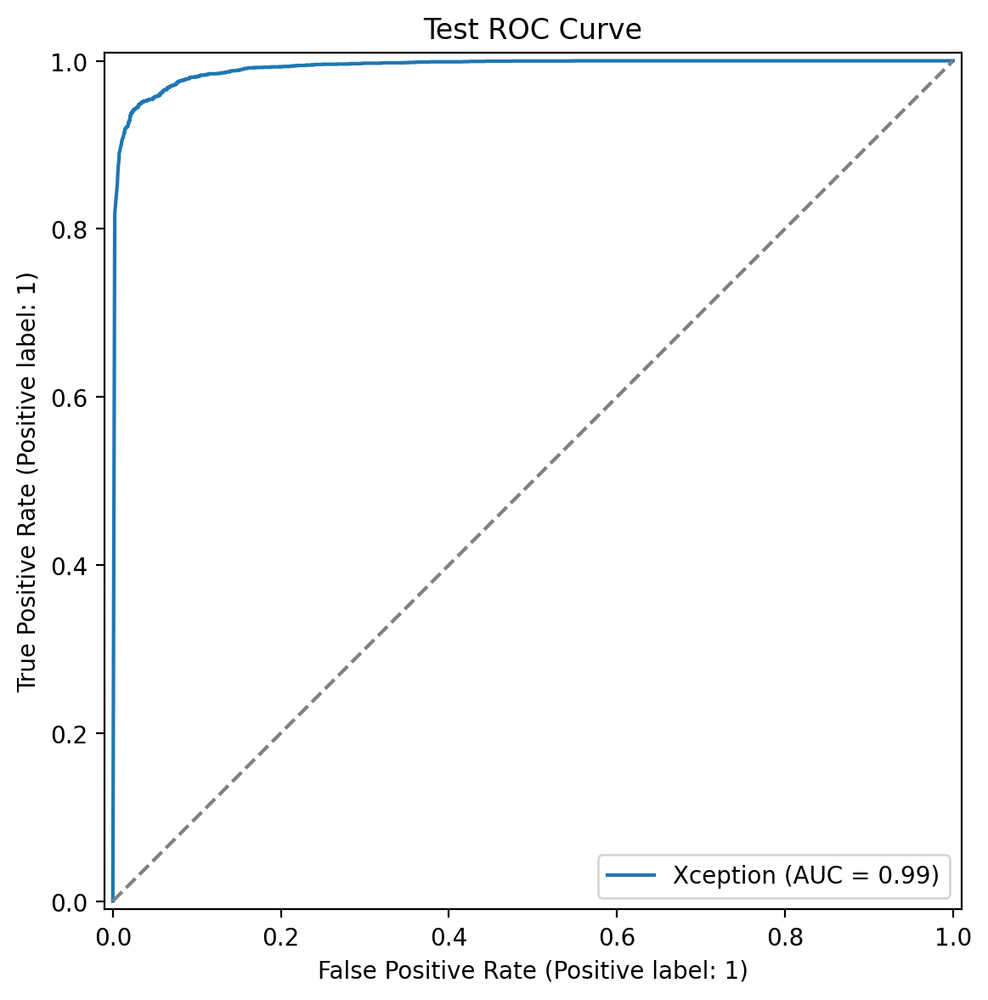

*Test ROC curve confirming high discriminative power on held-out identities.*

### Validation Error Gallery

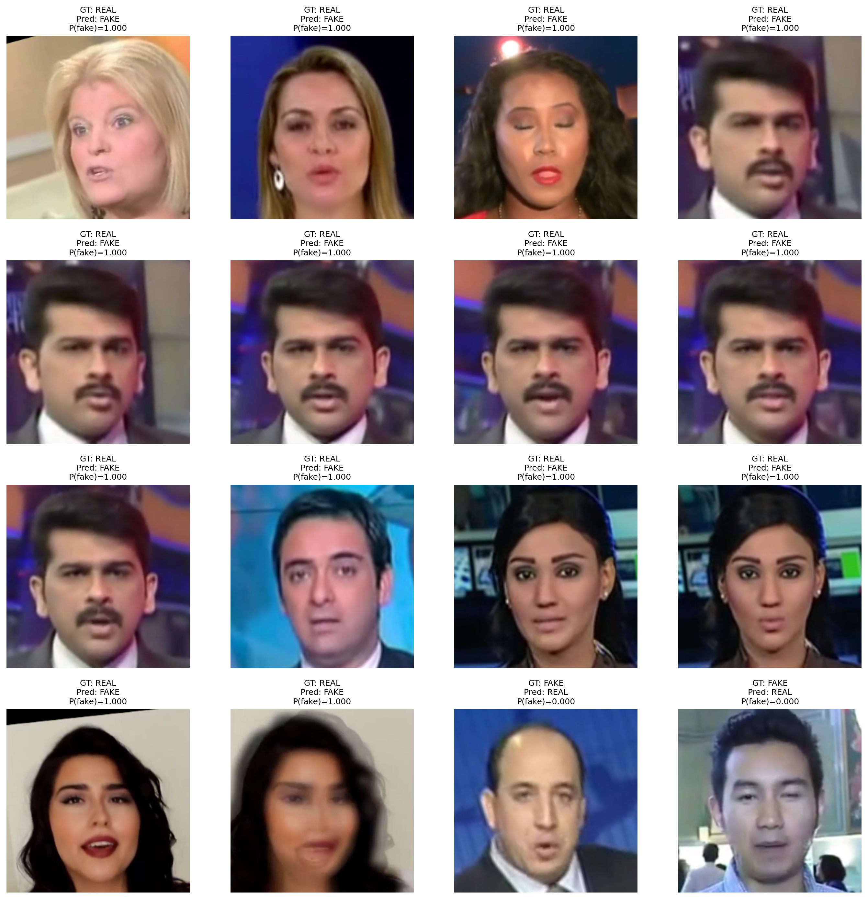

*Representative difficult validation examples to support qualitative analysis.*

### Test Error Gallery

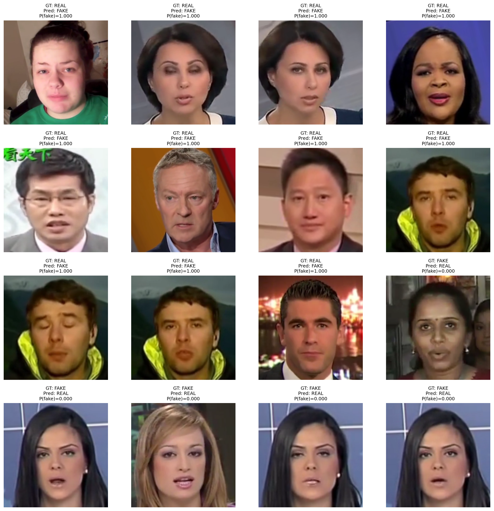

*Representative held-out failure cases useful for discussion and future work.*

## Inference Pipeline and Deployment

The deployment pipeline uses the fine-tuned checkpoint directly. The backend now applies the same preprocessing used during training: **`299x299` resize with ImageNet normalization**. Face detection is handled exclusively through **`from mtcnn import MTCNN`**, and the face crop includes a modest margin to preserve the jawline and the area around the head.

### Backend Capabilities

- `/health` for runtime status and threshold verification
- `/predict-image` for single-image analysis
- `/predict-image-batch` for multi-image summary mode
- `/predict-video` for ratio-based video classification
- `/ws/predict-video` for streaming progress updates
- `/generate-report` for PDF export

### Frontend Capabilities

- Image, video, batch, and comparison modes
- Adjustable image and video thresholds
- WebSocket progress stream during video processing
- Video decision trace with trigger-frame chips
- Top-frame gallery with Grad-CAM visualization
- Session history and report export

## Component Verification

### Model Loader

- Model class: **Xception**
- Parameter count: **20,809,001**
- Trainable parameters: **20,809,001**
- Face detector backend: **mtcnn**

### Face Detection and Cropping

- Detection confidence: **99.86%**
- Bounding box: **[517, 131, 700, 377]**

### Original Face-Detection Input

*Original sample used to verify face localization.*

### Annotated Face Detection

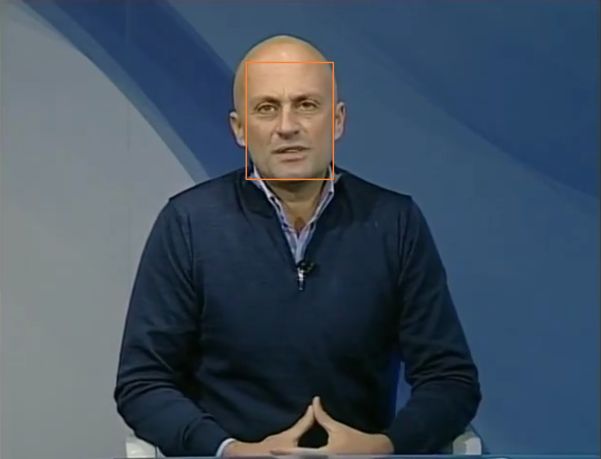

*Detected face bounding box overlaid on the original image.*

### Expanded Face Crop

*Slightly enlarged face crop used for downstream model inference.*

### Image Prediction

- Verification sample: `C:\Users\Harshal\OneDrive\Pictures\Screenshots\ladies_fake.png`
- Result: **FAKE**
- Confidence: **99.98%**
- Threshold used during check: **0.50**

### Analyzed Face

*Final face crop passed through the classifier for the sample fake-image check.*

### Explainability

### Explainability Input Face

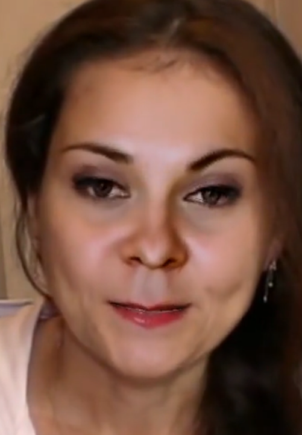

*Face crop used for attribution generation.*

### Grad-CAM

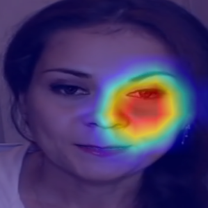

*Heatmap highlighting regions that most influenced the classifier output.*

### LIME

*Superpixel-based explanation illustrating local decision evidence.*

### Face Landmarks and Metadata

- Landmark count: **5**
- Metadata flags: **No EXIF metadata present**

### Landmark Overlay

*Five-point facial landmark overlay on the analyzed face crop.*

### Video Verification

- Verification clip: `E:\CSMSS Projects\Sem6_mini_project\FaceForensics++_C23\NeuralTextures\058_039.mp4`
- Final decision: **FAKE**
- Average confidence: **92.92%**
- Fake-frame ratio: **88.52%**
- Fake-frame count: **54 / 61**
- Frame fake threshold: **0.85**
- Video fake-ratio threshold: **0.40**
- Representative trigger frames: **0, 10, 20, 30, 70, 80, 90, 100, 110, 120, 130, 140, 150, 160, 170, 180, 200, 220, 230, 240, ...**

Decision trace:

> Marked FAKE because 54/61 analyzed frames (88.52%) crossed the per-frame fake threshold, meeting the video ratio threshold of 40.00%. Trigger frames: 0, 10, 20, 30, 70, 80, 90, 100, 110, 120, 130, 140, 150, 160, 170, 180, 200, 220, 230, 240, 250, 260, 270, 280, 290, 300, 310, 320, 330, 340, 350, 360, 370, 380, 390, 400, 410, 420, 430, 440, 450, 460, 470, 480, 490, 500, 510, 520, 530, 540, 550, 570, 580, 590

### Top Video Frame 1

*Representative high-confidence manipulated frame from the test video.*

### Top Video Face Crop 1

*Detected face crop corresponding to the first top suspicious frame.*

### Top Video Grad-CAM 1

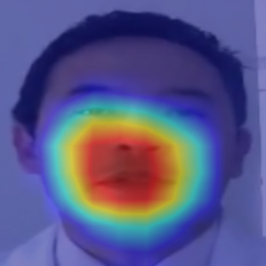

*Grad-CAM explanation for the highest-scoring suspicious video frame.*

### Top Video Frame 2

*Second representative manipulated frame from the verification run.*

### Top Video Face Crop 2

*Detected face crop corresponding to the second suspicious frame.*

### Top Video Grad-CAM 2

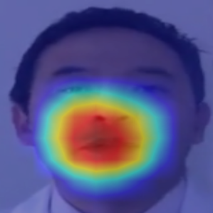

*Grad-CAM explanation for the second suspicious frame.*

### Top Video Frame 3

*Third representative manipulated frame from the verification run.*

### Top Video Face Crop 3

*Detected face crop corresponding to the third suspicious frame.*

### Top Video Grad-CAM 3

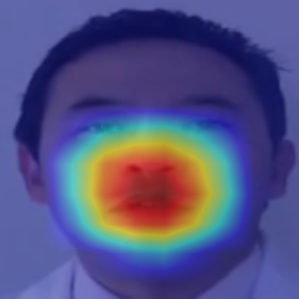

*Grad-CAM explanation for the third suspicious frame.*

## Discussion

The project demonstrates that fine-tuning the XceptionNet backbone on the provided local dataset was more effective than relying on the original pretrained checkpoint. The final model achieves strong validation and test performance while remaining usable in a practical analysis interface. The identity-grouped split materially improves the credibility of the reported numbers by reducing subject leakage between partitions.

The most important engineering change after training was ensuring the backend exactly mirrored the fine-tuning pipeline. Once the deployment code was updated to use the new `best_model.pt`, apply `299x299` resizing with ImageNet normalization, and use MTCNN-only face detection with a better crop margin, the inference behavior became much more consistent with expectations.

## Limitations

1. Reported performance is still dataset-dependent and may drop under unseen manipulations, compression regimes, or demographic shifts.
2. The current video classifier relies on sampled frames rather than full temporal modeling.
3. Metadata forensics is intentionally lightweight and should be treated as supporting evidence rather than a primary decision source.
4. The pipeline currently assumes a single dominant face per frame and uses the top-confidence face detection.

## Future Work

1. Calibrate decision thresholds directly from validation-score distributions for stricter operating-point control.
2. Add temporal consistency modeling for videos to reduce frame-level noise.
3. Expand multi-face handling for crowded scenes or interview-style content.
4. Introduce external benchmark comparisons and ablation studies for explainability and crop-margin sensitivity.

## Reproducibility and Artifact Map

### Key Source Paths

- Training entry point: `own_train/train_xception.py`
- Data split logic: `own_train/data.py`
- Plot generation: `own_train/plotting.py`
- Backend API: `backend/main.py`
- Inference pipeline: `backend/predictor.py`
- Explainability: `backend/explainability.py`
- Metadata analysis: `backend/forensics.py`
- Landmark overlay: `backend/face_landmarks.py`
- PDF export: `backend/report_generator.py`
- Frontend dashboard: `frontend/src/App.jsx`

### Bundled Evidence Files

- Final metrics: `artifacts/final_report.json`
- Split summary: `artifacts/split_summary.json`
- Training config: `artifacts/config.json`
- Model loader verification: `artifacts/model_loader.json`
- Face detection verification: `artifacts/face_detection.json`
- Image prediction verification: `artifacts/image_prediction.json`
- Explainability verification: `artifacts/explainability.json`
- Forensics verification: `artifacts/forensics.json`
- Landmark verification: `artifacts/landmarks_result.json`
- Video verification: `artifacts/video_pipeline.json`

## Conclusion

This project now includes a complete, fine-tuned deepfake detection workflow spanning training, evaluation, explainability, API deployment, and frontend presentation. The final XceptionNet model trained on the provided dataset reached **95.37% test accuracy** and **0.9919 test AUC**, while the surrounding platform supports single-image, batch, and video analysis with interpretable outputs. The report package generated here is intended to serve directly as a publication-ready project document and as a durable artifact bundle for future submission, export, or extension.
